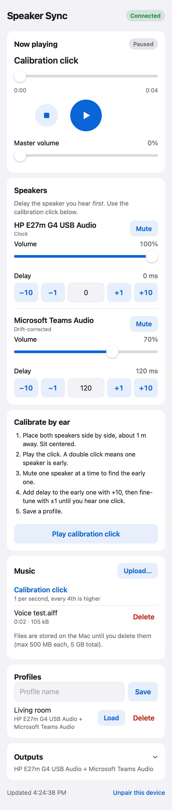
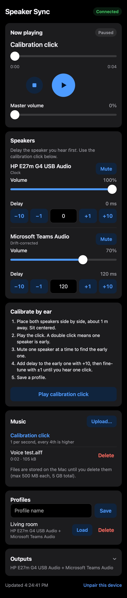

# speaker-sync

Play a local audio file, or live Mac audio such as Spotify, through two Bluetooth speakers (JBL Go 4 + JBL Charge 5) from a Mac mini, with per-speaker volume and delay, controlled from iPhone Safari. The Mac does all the audio work; the iPhone is only a remote.

 

## What works

**Verified on your hardware**
- Both JBLs play the same audio at the same time from the Mac (44.1 kHz, about 9 min, 0 overloads).
- Turning a speaker off stops playback and reports it. Nothing plays from the Mac's own speaker.
- The service runs with both speakers; Reconnect works after a speaker comes back. The iPhone reaches the service over Wi-Fi.
- No audible drift over about 9 minutes.
- Live Spotify audio on both speakers through the command-line tool (`ssync-poc live --app com.spotify.client`).

**Implemented, tested on the Mac only** (non-Bluetooth devices or desktop WebKit)
- Per-speaker delay (0–2000 ms) and volume, master volume, play/pause/stop/seek, calibration click.
- Upload and library, saved profiles, restore after restart (always paused).
- Mobile web UI, token pairing, LAN-only access.
- Start at login, restart after a crash, keep the Mac awake only while playing.
- Live sources in the service and UI: **Spotify** or **All Mac audio**, with a level meter and a hint when nothing arrives.
- Up to 8 outputs at once (e.g. Charge 5 + Go 4 + HP monitor + Mac mini speaker), each with its own volume, delay and optional limiter.
- Optional per-speaker **level limiter**: a dB ceiling that turns down loud peaks on that speaker only, with a live "limiting −N dB" readout.

**Depends on your hardware; still to test** (see [docs/TESTING.md](docs/TESTING.md))
- The web UI on iPhone Safari.
- Live audio through the installed service. It needs the System Audio Recording permission for SpeakerSync.app.
- Alignment over 30+ minutes.
- Whether a saved delay stays right after the speakers reconnect. Bluetooth latency can change on each reconnect.
- Mixing Bluetooth (44.1 kHz) and wired (48 kHz) outputs in one group: the shared clock must run them all at one rate.

**Not implemented**
- Automatic (microphone) calibration, playlists/queues.
- Streaming-service integration (control Spotify in Spotify itself, or via Spotify Connect), TVs and headphones.
- HTTPS. A signed or notarised app bundle.

**Not promised:** sample-accurate sync. The app aligns what it sends to each speaker. Each speaker's own Bluetooth and processing delay is unknown and is corrected by ear.

## Install

### From the DMG (any Mac with macOS 15+, Apple silicon or Intel)

1. Download `SpeakerSync-<version>.dmg` from [Releases](https://github.com/umutykaya/speaker-sync/releases) and drag **SpeakerSync** onto Applications.
2. Open it. The app is not notarized (no paid Apple Developer ID), so macOS blocks the first open: System Settings → Privacy & Security → scroll down → **Open Anyway** next to SpeakerSync → confirm.
3. The web page opens and a speaker icon appears in the menu bar. Pick your speakers under Outputs. Menu bar icon → **Copy iPhone pairing link** for the phone.
4. It starts at login (menu bar → **Open at Login** to change). Allow incoming connections and System Audio Recording when macOS asks.

Don't use both the DMG app and `scripts/ssync.sh install` on the same Mac: they share port 8095 and settings. To remove the app: menu bar → Quit, turn off Open at Login, delete it from Applications. Settings stay in `~/Library/Application Support/SpeakerSync`.

Build a DMG yourself: `scripts/package.sh <version>` → `dist/SpeakerSync-<version>.dmg` (universal binary, ad-hoc signed).

### From source (LaunchAgent)

Requirements: macOS with Xcode command-line tools (Swift 6), Node.js (only to build the UI), both speakers paired and connected in System Settings → Bluetooth. Turn off PartyBoost/Auracast linking.

```sh
cd ~/projects/speaker-sync
scripts/ssync.sh install     # builds, copies to ~/Library/Application Support/SpeakerSync/app, starts at login
scripts/ssync.sh link        # pairing link to open on the iPhone
```

Open the pairing link in Safari on the iPhone, on the same Wi-Fi. Optionally use Share → Add to Home Screen. If macOS asks whether `ssyncd` may accept incoming connections, choose **Allow**.

Other commands: `scripts/ssync.sh status | logs | restart | start | stop | rotate-token | uninstall`. `stop` keeps it installed; it starts again with `start` or at the next login. Uninstall keeps your settings and music.

After changing code, run `scripts/ssync.sh install` again.

## Use

1. **Outputs:** tick the speakers you want, up to 8; the first one ticked becomes the clock. Tap "Use selected outputs". Wired outputs (Mac speaker, USB monitor) play much earlier than Bluetooth, so they need the larger delay.
2. **Calibrate:** tap "Play calibration click". With the speakers side by side, delay the speaker you hear **first**: +10 to get close, ±1 to fine-tune, until you hear one click. Mute one speaker to tell which is early.
3. **Optional, Limit level:** turn it on for a speaker that drowns out the others, and set its ceiling (−40…0 dB). Loud peaks on that speaker are held under the ceiling; quieter parts and the other speakers are unchanged. The ceiling applies to the signal sent to that speaker, not the room loudness: the speaker's own volume buttons still matter.
4. **Save a profile.** It includes delays, volumes and limiter settings.
5. **Music:** Upload… picks a file from the iPhone (Files app). Tap a track to load it, then Play.
6. **Spotify / Mac audio:** under Music, tap **Spotify** (or **All Mac audio**), then press Play to unmute the speakers. Start music in Spotify on the Mac, or pick the Mac in Spotify Connect on your phone. Spotify's own output is muted while it plays through the speakers. Play/pause in this UI only mutes the speakers; Spotify keeps playing.
   - The first time, macOS should ask to allow **SpeakerSync** to record system audio. If the meter stays at "silent" while music plays: System Settings → Privacy & Security → Screen & System Audio Recording → System Audio Recording Only → **+** → `~/Library/Application Support/SpeakerSync/app/SpeakerSync.app`, then tap Reconnect. Reinstalling (a new build) may require allowing it again.
   - Live audio uses the same speaker delays as files: calibrate once with the click.

Locking the iPhone or closing Safari does not affect playback. When you come back, the page shows the Mac's current state.

**Menu bar:** a speaker icon in the Mac's menu bar shows the state at a glance:
filled speakers = playing, outline = speakers connected, ⚠ = a selected speaker
is not connected, crossed-out speaker = no speakers selected. Its menu lists
each speaker (✓ connected / ✗ not connected), a master volume slider (same as
the web UI), and Play/Pause, Stop,
Reconnect speakers, Open Speaker Sync (opens the web UI on the Mac, already
paired) and Copy iPhone pairing link. The DMG app also has Open at Login and Quit.
Installed with `scripts/ssync.sh` there is no Quit: the LaunchAgent would
restart it; use `scripts/ssync.sh stop`.

## Troubleshooting

| Symptom | Check |
|---|---|
| Page doesn't load at all | `scripts/ssync.sh status`. If the agent is not loaded or the port is not listening, run `scripts/ssync.sh install`, then check `scripts/ssync.sh logs`. |
| Loads on the Mac, not on the iPhone | Same Wi-Fi network? Use the Mac's LAN address (from `link`), not `127.0.0.1`. Firewall: run the two `socketfilterfw` commands printed by `install`. iPhone with a VPN or Private Relay: try with it off. |
| "Pairing expired" / pairing screen | Run `scripts/ssync.sh link` and open the new link. The token changes only with `scripts/ssync.sh rotate-token`. |
| Red banner "… not connected" | Connect the speaker in System Settings → Bluetooth, then tap **Reconnect**. |
| Red banner "Can't reach the Mac" | The service stopped or the Mac is asleep/offline. Playback on the Mac (if running) is unaffected. The page recovers on its own. |
| Speakers out of sync after a reconnect | Expected with Bluetooth: re-run the calibration click and adjust. Record it in docs/TESTING.md. |
| One speaker silent or stuttering | Check `scripts/ssync.sh logs`. Move speakers closer to the Mac; 2.4 GHz Wi-Fi and USB 3 hubs can interfere with Bluetooth. |
| Spotify selected, meter says "silent" | Is Spotify playing on this Mac (not on the phone)? Then check the System Audio Recording permission (see Use, step 5) and tap Reconnect. |
| Spotify heard twice / from the Mac too | Shouldn't happen: the tap mutes Spotify's normal output. Tap Reconnect; if it persists, check `scripts/ssync.sh logs`. |
| Mac sleeps during playback | It shouldn't while playing (`pmset -g assertions` shows "Speaker Sync is playing"). Manual sleep or closing a lid still sleeps it. |

Logs: `~/Library/Logs/SpeakerSync/ssyncd.log`. Settings and music: `~/Library/Application Support/SpeakerSync/`.

## Security

- LAN only: requests from outside private address ranges get 403. **Do not port-forward 8095 or put it behind a tunnel.**
- Every API call needs the pairing token. It is a random 128-bit value stored with owner-only permissions.
- Plain HTTP: another device on your Wi-Fi could sniff the token. Run `scripts/ssync.sh rotate-token` if you're in doubt; it prints the new link.
- Uploads: audio types only, checked by decoding the file, 500 MB per file, 5 GB total. File names never become paths.

## Project layout

| Path | What |
|---|---|
| `Sources/AudioEngine` | CoreAudio: device listing, private aggregate device, file player, live player, process tap, decoding, click track |
| `Sources/ssyncd` | Service: HTTP API (Hummingbird 2), state, persistence, auth |
| `Sources/ssync-poc` | Command-line test tool from milestone 1 |
| `web/` | UI: plain TypeScript (`src/app.ts`) + `public/` → `dist/` |
| `scripts/ssync.sh` | Install/run as a LaunchAgent |
| `docs/` | [Architecture](docs/ARCHITECTURE.md), [API](docs/API.md), [Testing and results](docs/TESTING.md) |

## Limitations

- Whole files are decoded into memory: about 23 MB per minute at 48 kHz stereo float. That's fine for songs, not for 3-hour mixes.
- One file at a time; no queue or gapless playback.
- Live sources have no seek or track info. Use the app (Spotify) for that.
- Live audio adds a little latency (capture + one I/O cycle), the same for both speakers.
- Delay changes while playing crossfade over 30 ms. Large jumps briefly repeat or skip audio.
- The service runs only while you are logged in. That's a requirement for Bluetooth audio, not a bug.
- The position on the page updates once per second, smoothed locally in between.
- The audio callback has not been profiled for real-time safety. It avoids locks, allocation and I/O by design.
